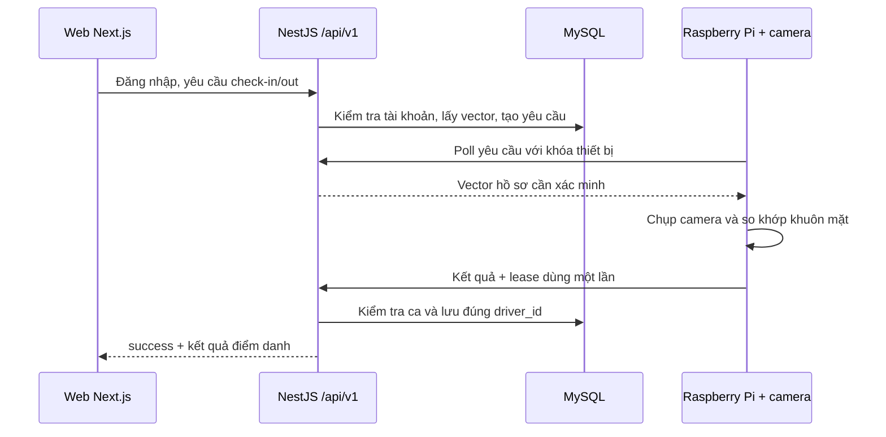

# DriverHub

Next.js 16 + React 19 + Tailwind CSS 4: tím nhạt, viền rõ, bóng cứng, font tối đa medium (500). NestJS + MySQL quản lý tài khoản, hồ sơ và điểm danh. Đăng ký ảnh/video dùng model khuôn mặt trên máy local; chấm công dùng model và camera trên Raspberry Pi.

Hướng dẫn đầy đủ: [Đăng ký khuôn mặt và kết nối Raspberry Pi](README_FACE_ATTENDANCE.md).

Style nằm trong utility Tailwind ở các component. `frontend/src/app/tailwind.css` chỉ nạp Tailwind; không có stylesheet tùy chỉnh. Không nạp Preflight để giữ các giá trị mặc định và giao diện hiện có.

## Chạy local

```powershell
cd G:\IOTDOAN\backend
npm install
npm run db:init
npm run dev
```

Admin mặc định: **ad / ad**. `db:init` tạo admin nếu chưa có, không ghi đè mật khẩu cũ. Có thể đặt `ADMIN_USERNAME`, `ADMIN_PASSWORD`, `ADMIN_NAME` trước khi khởi tạo.

```powershell
cd G:\IOTDOAN\frontend
npm install
npm run dev
```

Web: http://localhost:3001. Lệnh dev nhận biết DriverHub đang chạy để tránh tranh cổng. `frontend/.env`:

```dotenv
BACKEND_URL=http://127.0.0.1:3000/api/v1
COOKIE_SECURE=false
```

Swagger: http://localhost:3000/api/v1/docs; `/api/docs` vẫn hoạt động. Gọi `POST /api/v1/auth/login`, lấy `data.token`, bấm **Authorize** và nhập token cho Bearer.

## Chuẩn API

Mọi API nghiệp vụ có tiền tố `/api/v1`. Thành công:

```json
{"success":true,"data":{}}
```

Danh sách trả mảng trong `data`. Lỗi giữ HTTP status đúng (400, 401, 403, 409, 503…):

```json
{"success":false,"data":null,"message":"Vui lòng đăng nhập."}
```

Các API chính: `/auth/login`, `/auth/register`, `/auth/me`, `/drivers`, `/attendance`, `/telemetry`, `/recognition/enroll`, `/recognition/attendance`, `/recognition/history`, `/recognition/status`; tất cả đặt sau `/api/v1`.

## Vai trò và hồ sơ

- **Admin:** quản lý hồ sơ, thêm ảnh, tạo tài khoản tài xế liên kết, phân quyền, xem điểm danh, telemetry và lịch sử vi phạm của từng tài xế.
- **Người dùng:** xem hồ sơ cá nhân và đăng ký trở thành tài xế.
- **Tài xế:** đăng ký ảnh/video khuôn mặt trên web bằng model local, check-in/check-out tại camera Pi và xem lịch sử cá nhân.

Form đăng ký tài xế chỉ yêu cầu thông tin tài khoản và hồ sơ, không cần ảnh hoặc AI. Sau khi đăng ký, web chuyển đến Hồ sơ; chọn **Camera trực tiếp** để tự lấy ba mẫu theo hướng dẫn nhìn thẳng, quay nhẹ trái/phải, hoặc chọn **Ảnh / video** để tải ảnh chân dung hay tải/quay video. Bộ dò YuNet kiểm tra vị trí mặt nhanh; dlib kiểm tra danh tính các mẫu và lưu theo đúng ID tài xế. Xác nhận không phụ thuộc Pi; check-in/check-out cần khuôn mặt đã xác nhận và Pi online. Chạy migration `npm run db:face-datasets` trong backend cho database hiện có và chạy model local theo README hướng dẫn.

Trang `/admin/violations` có ô tìm theo tên (có/không dấu), mã hoặc số điện thoại, chọn tài xế, lọc ngày UTC+7, loại và mức độ cảnh báo, phân trang và xem ảnh. Nút **Vi phạm** tại mỗi dòng trong **Quản lý tài xế** mở đúng hồ sơ đó. API `GET /api/v1/telemetry/drivers/:driverId/alerts` chỉ dành cho admin; sử dụng các tham số `date`, `type`, `level`, `page`, `page_size` như lịch sử của tài xế.

Kiểm tra frontend: `npm run typecheck`, `npm run build`. Kiểm thử phân quyền và validation API admin không cần MySQL: chạy `npm run test:admin-alerts` trong `backend`.

## Raspberry Pi, FE và BE riêng domain



Pi kết nối HTTPS ra server; không cần public camera, mở cổng Pi hoặc truy cập MySQL trực tiếp. `DEVICE_API_KEY` chỉ có trên BE/Pi, không nằm trong FE. Server kiểm tra phiên, tài xế còn hoạt động và trạng thái ca trước khi ghi nhận.

BE `.env`:

```dotenv
AI_MODEL_URL=http://127.0.0.1:8000
RECOGNITION_DEVICE_ID=raspi_cam_01
DEVICE_API_KEY=<khóa thiết bị ngẫu nhiên>
```

Pi `ai_model/.env`:

```dotenv
SERVER_URL=https://api.driver.example.com/api/v1
DEVICE_ID=raspi_cam_01
DEVICE_API_KEY=<cùng khóa với backend>
CAMERA_BACKEND=opencv
CAMERA_INDEX=0
SHOW_PREVIEW=false
CAPTURE_TIMEOUT=12
FACE_DISTANCE_THRESHOLD=0.52
```

Cài `requirements.txt` vào môi trường Python rồi chạy `python pi_worker.py`. USB camera dùng `opencv`; camera CSI dùng `CAMERA_BACKEND=picamera2` và gói `python3-picamera2` của Raspberry Pi OS với virtualenv dùng system packages. Chỉnh user/thư mục trong `driverhub-pi.service` để chạy systemd. Không chạy hai chương trình giữ độc quyền cùng camera.

Windows: chạy `ai_model/setup-windows.ps1`, sau đó `.venv\Scripts\python.exe pi_worker.py`. Virtualenv và cấu hình local hiện tại phục vụ kiểm tra trên máy phát triển; chưa triển khai lên Raspberry Pi thật.

## Dữ liệu lưu ở đâu

- MySQL `drivers`: thông tin tài xế, vector 128 chiều `face_embedding`, ảnh JPEG thu nhỏ trong `avatar_url` dạng data URL.
- `accounts`, `sessions`: mật khẩu scrypt và hash token; trình duyệt dùng cookie HttpOnly.
- `attendances`: ID tài xế, thời gian, check-in/out, điểm tương đồng và mã thiết bị.
- `driver_face_datasets`: ảnh mẫu đã nhận diện, vector từng ảnh và video đăng ký gốc dạng BLOB. Bộ mẫu được lưu cùng hồ sơ trong giao dịch MySQL.
- `recognition_jobs`: yêu cầu/kết quả tạm cho Pi. Payload được xóa khi server nhận kết quả hoặc hết hạn; bản ghi hàng đợi cũ được dọn sau 24 giờ.
- Ảnh cảnh báo được lưu thành file tại `backend/uploads/drivers/<driver_id>/alerts/<uuid>.jpg` (hoặc PNG/WebP). MySQL chỉ giữ đường dẫn trong `telemetry.snapshot_url`; cấu hình `UPLOAD_DIR` để chọn ổ lưu ảnh riêng và giữ dữ liệu qua các lần deploy. Model/weights nằm trong môi trường Python trên Pi.

## Lịch sử cảnh báo tài xế

Trang riêng `/driver/alerts` (mục **Lịch sử cảnh báo** trong sidebar) xem theo ngày Việt Nam UTC+7, lọc ngủ gật/mất tập trung/ngáp và mức độ, tự cập nhật mỗi 30 giây, phân trang và xem ảnh lớn. API `GET /api/v1/telemetry/my-alerts?date=2026-11-05&type=all&level=all&page=1&page_size=8` luôn lấy ID tài xế từ phiên đăng nhập, không nhận ID tài xế khác từ client.

Pi gửi `POST /api/v1/telemetry` với header `x-device-key` và JSON gồm `device_id`, `driver_id`, các cờ DMS, `alert_level` và `snapshot_base64` dạng `data:image/jpeg;base64,...` (tối đa 3 MB). Backend lưu file ảnh theo ID tài xế và trả URL. API đọc ảnh yêu cầu đăng nhập; tài xế chỉ xem được ảnh của mình, admin có thể xem tất cả. Thời gian trong lịch sử là thời điểm backend nhận và lưu bản tin.

Có thể gọi helper trong vòng lặp model DMS trên Pi:

```python
from telemetry_client import DmsTelemetryClient

telemetry = DmsTelemetryClient()  # đọc ai_model/.env
# Khi model phát hiện cảnh báo; frame là ảnh camera OpenCV hiện tại.
telemetry.send_alert(driver_id, frame, drowsiness=True, level='WARNING', eye_aspect_ratio=0.18)
```

Helper gửi ảnh JPEG cùng dữ liệu; cần gắn lời gọi này vào nhánh cảnh báo của chương trình DMS thật trên Raspberry Pi. Không gửi liên tục mọi frame.

Model hiện chưa có chống giả mạo ảnh/video (liveness); độ tương đồng không phải xác suất nhận diện. Cần kiểm tra ánh sáng, góc camera và ngưỡng trên Pi thật trước khi dùng chấm công chính thức.

## Deploy

Git lưu mã nguồn hệ thống chính, notebook huấn luyện và model YuNet nhẹ phục vụ dò mặt. `IOT/` và `dms_model_test/` là các mẫu test local, được bỏ qua cùng file nén, dataset, log, cache, bản backup và weights lớn. Dữ liệu SFace của app test được đặt tại `ai_model/drivers.json` và cũng được Git bỏ qua. Hồ sơ và mẫu khuôn mặt đăng ký qua web của hệ thống chính được lưu trong MySQL theo ID tài xế.

Thay domain trong `nginx.conf`. FE đặt `BACKEND_URL=https://api.driver.example.com/api/v1` và `COOKIE_SECURE=true`. Next.js gọi BE phía server; trình duyệt không cần giữ Bearer token. Bật HTTPS cho hai domain; proxy timeout tối thiểu 75 giây.

`deploy.sh` build FE/BE và restart PM2 trên cùng máy. Nếu FE/BE ở hai máy, dùng config PM2 tương ứng trên mỗi máy. Raspberry Pi chạy worker riêng với URL domain backend.

## Kiểm tra

FE và BE đều dùng `npm run build`. Luồng mới được kiểm tra bằng `backend/scripts/verify-face-registration.mjs`: model local thật, bộ mẫu/video lưu MySQL, hàng đợi Pi và kiểm tra ca làm. Script dùng database tạm và video thay camera, tự xóa database sau khi chạy; xem cách cung cấp fixture trong [README hướng dẫn](README_FACE_ATTENDANCE.md). Chưa kiểm tra camera Pi thật.
