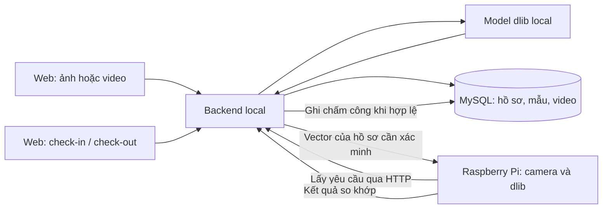

# Đăng ký khuôn mặt tại local, chấm công bằng Raspberry Pi

## Phân chia công việc

| Thành phần | Công việc |
| --- | --- |
| Frontend Next.js, cổng 3001 | Tạo tài khoản, vào Hồ sơ → Bắt đầu xác nhận, camera tự kiểm tra và lấy mẫu trực tiếp theo hướng dẫn, sau đó check-in/check-out |
| Model local, cổng 8000 | `face_recognition`/dlib: kiểm tra đúng một mặt trong mỗi ảnh mẫu, trích vector 128 chiều, kiểm tra các mẫu cùng người |
| Backend NestJS, cổng 3000 | Tạo tài khoản và hồ sơ chưa xác nhận; gọi model local khi xác nhận khuôn mặt, lưu mẫu theo ID tài xế, gửi yêu cầu chấm công cho Pi |
| Raspberry Pi | Tự chụp ảnh camera, dùng cùng model dlib để đối chiếu vector đã đăng ký, gửi kết quả về backend |
| MySQL | Hồ sơ và tài khoản, vector nhận diện, bộ ảnh mẫu, video đăng ký gốc, lịch sử chấm công |

Nhân viên trong hệ thống hiện dùng hồ sơ/vai trò `driver` (tài xế). Luồng này xác minh khuôn mặt với **tài khoản nhân viên đang đăng nhập**, không tự dò danh tính của mọi người đi ngang camera.

Model YOLO DMS trong thư mục IOT nhận diện hành vi/buồn ngủ/ngáp. Nó không thay cho model nhận diện danh tính. Nếu Pi đã có DMS, giữ nguyên bộ đó; chương trình `ai_model/pi_worker.py` cần có thêm `face_recognition` tương thích với phía local. Không cần train lại hoặc nạp lại YOLO khi thêm nhân viên.



## 1. Chuẩn bị MySQL và backend trên máy local

Mở MySQL trước. Sửa `backend/.env` bằng thông tin thực tế; không đưa file này lên Git:

```dotenv
PORT=3000
MYSQL_HOST=127.0.0.1
MYSQL_PORT=3306
MYSQL_USER=your_mysql_user
MYSQL_PASSWORD=your_mysql_password
MYSQL_DB=iotdb
AI_MODEL_URL=http://127.0.0.1:8000
RECOGNITION_DEVICE_ID=raspi_cam_01
DEVICE_API_KEY=replace_with_one_random_secret_shared_with_pi
```

Tạo khóa bằng `node -e "console.log(require('node:crypto').randomBytes(32).toString('hex'))"`, rồi đặt **cùng một giá trị** tại backend và Pi. Không đặt khóa thiết bị trong frontend. Tạo tài khoản không cần model; xác nhận khuôn mặt dùng model local; chấm công luôn qua Pi.

Với database đang dùng, chỉ bổ sung bảng bộ dữ liệu khuôn mặt:

```powershell
cd G:\IOTDOAN\backend
npm run db:face-datasets
npm run build
npm run start:prod
```

Với database mới hoàn toàn, dùng `npm run db:init` trước; script tạo các bảng cần thiết và tài khoản quản trị theo cấu hình hiện có. Migration bộ dữ liệu chỉ `CREATE TABLE IF NOT EXISTS`, không xóa hồ sơ/lịch sử cũ. MySQL nên cấu hình `max_allowed_packet` ít nhất `32M` để lưu video đến 8 MB cùng dữ liệu mẫu.

## 2. Chạy model đăng ký trên máy local

Nếu `ai_model/.venv` đã có đủ thư viện thì dùng lại, không cài hoặc tải lại model:

```powershell
cd G:\IOTDOAN\ai_model
.\.venv\Scripts\python.exe -c "import face_recognition, cv2, fastapi, uvicorn; print('Ready')"
.\.venv\Scripts\python.exe -m uvicorn api:app --host 127.0.0.1 --port 8000
```

Nếu thiếu môi trường Windows, chạy `setup-windows.ps1` một lần. Trong lần cài mới, script cài thư viện nhận diện khuôn mặt, không huấn luyện model nhân viên.

Kiểm tra `http://127.0.0.1:8000/health`: trả `status=ready`, `model=face_recognition`. Dịch vụ này chỉ phục vụ backend, không cần mở cổng 8000 cho Pi hoặc công khai ra Internet.

## 3. Chạy frontend và đăng ký nhân viên

Kiểm tra `frontend/.env.local` theo file ví dụ trong dự án, trỏ `BACKEND_URL` về backend (`http://127.0.0.1:3000`). Frontend tự thêm `/api/v1` theo `src/lib/server.ts`.

```powershell
cd G:\IOTDOAN\frontend
npm run dev
```

Mở `http://localhost:3001/register`, nhập họ tên, email, mật khẩu, số điện thoại và giấy phép lái xe rồi bấm **Đăng ký tài xế**. Bước này tạo tài khoản và hồ sơ tài xế chưa có khuôn mặt, không yêu cầu ảnh/video hoặc dịch vụ AI đang chạy. Sau khi đăng nhập tự động, web chuyển đến **Hồ sơ của tôi**.

Trong **Hồ sơ → Xác nhận khuôn mặt**, chọn **Camera trực tiếp** hoặc **Ảnh / video** rồi bấm **Bắt đầu xác nhận**. Camera trực tiếp hướng dẫn ba bước **Nhìn thẳng → Quay nhẹ sang trái → Quay nhẹ sang phải**. Giữ đầu thẳng và chỉ quay mặt nhẹ để camera vẫn thấy cả hai mắt. Chế độ **Ảnh / video** hỗ trợ tải 1–8 ảnh chân dung, tải video MP4/WebM hoặc bật camera để chụp/quay video, rồi bấm **Xác nhận và lưu khuôn mặt**.

Web gửi từng khung hình qua API có đăng nhập `POST /api/v1/recognition/preview` đến model local `/preview`. YuNet dò vị trí mặt; model kiểm tra số khuôn mặt, vị trí/khoảng cách, ánh sáng, độ nét và hướng mặt. Mỗi bước cần ba khung hình đạt yêu cầu trong khoảng giữ mặt ngắn; cho phép một lần mất dấu tạm thời nhưng không lấy mẫu từ khung hình mất dấu. Sai tư thế, nhiều người, ảnh mờ hoặc mất dấu liên tục sẽ bắt đầu lại lượt giữ mặt. Vector nhận diện dlib chỉ được tính khi lưu mẫu, giúp camera phản hồi nhanh hơn. Mẫu đang xem trước không được lưu vào database.

Khi hoàn tất ba bước, camera tự dừng và ba mẫu được gửi đến `recognition/enroll`. Backend lấy ID tài xế từ phiên đăng nhập, model kiểm tra các mẫu cùng một người rồi lưu vector và bộ mẫu trong cùng giao dịch MySQL, gắn với đúng hồ sơ đó. Chỉ báo thành công sau khi lưu xong. Nếu lưu lỗi, có thể thử lưu lại hoặc lấy lại mẫu. Hủy thao tác/đổi trang sẽ dừng camera và hủy yêu cầu đang chờ. Chưa có khuôn mặt đã lưu thì không thể chấm công.

Đây là luồng căn mặt và lấy mẫu camera trực tiếp; các bước quay đầu không thay thế hệ thống chống giả mạo chuyên dụng hoặc eKYC ngân hàng.

Quản trị viên cũng có thể thêm/cập nhật ảnh hoặc video trong **Quản lý tài xế → Thêm/chỉnh sửa hồ sơ**. Tài xế cập nhật bộ mẫu ở **Hồ sơ → Xác nhận khuôn mặt → Cập nhật khuôn mặt**. Bộ mẫu mới thay bộ mẫu cũ khi lưu thành công. Trang Điểm danh có liên kết quay về phần xác nhận trong hồ sơ.

Xác nhận khuôn mặt trên máy local **không cần Pi bật**. Webcam trên web cần HTTPS hoặc localhost; khi mở web qua IP HTTP từ máy khác, phải cấu hình HTTPS. Form quản trị viên vẫn hỗ trợ ảnh/video có sẵn.

## 4. Kết nối Raspberry Pi với backend

Chép/cập nhật các file `ai_model/api.py`, `face_detection.py`, `pi_worker.py`, `requirements.txt` và thư mục `ai_model/models/` lên cùng một thư mục trên Pi, ví dụ `/home/pi/driverhub/ai_model`. Bộ dò mới vẫn tạo vector dlib 128 chiều; nếu chưa có weights YuNet thì dùng bộ dò HOG dự phòng. Không chép video nhân viên hoặc thông tin đăng nhập MySQL sang Pi.

Nếu Pi đã cài model khuôn mặt, kiểm tra trước:

```bash
cd /home/pi/driverhub/ai_model
.venv/bin/python -c "import face_recognition, cv2, numpy, requests, fastapi; print('Ready')"
```

Nếu chưa có môi trường Python, tạo và cài một lần theo hệ điều hành/kiến trúc Pi:

```bash
python3 -m venv .venv
.venv/bin/python -m pip install -r requirements.txt
```

Việc cài `dlib` trên Pi có thể cần CMake, trình biên dịch C++ và thư viện hệ thống; nếu môi trường hiện có đã chạy được, dùng lại môi trường đó.

Tạo `ai_model/.env` trên Pi:

```dotenv
SERVER_URL=http://192.168.1.10:3000/api/v1
DEVICE_ID=raspi_cam_01
DEVICE_API_KEY=the_same_secret_as_backend
CAMERA_INDEX=0
CAMERA_BACKEND=opencv
CAPTURE_TIMEOUT=12
SHOW_PREVIEW=false
FACE_DISTANCE_THRESHOLD=0.52
```

Thay `192.168.1.10` bằng IP LAN của máy chạy backend (xem bằng `ipconfig` trên Windows). **Không dùng `localhost` hoặc `127.0.0.1` trong SERVER_URL của Pi**, vì địa chỉ đó sẽ trỏ về chính Pi. `DEVICE_ID` phải giống `RECOGNITION_DEVICE_ID` của backend. Cho phép Pi truy cập TCP 3000 trên máy backend; không cần mở cổng trên Pi.

Với camera CSI dùng Picamera2, đổi `CAMERA_BACKEND=picamera2` và dùng môi trường có thư viện Picamera2 của Raspberry Pi OS. Với USB webcam dùng `opencv`; đổi `CAMERA_INDEX` nếu camera không phải số 0.

Chạy worker:

```bash
cd /home/pi/driverhub/ai_model
.venv/bin/python -u pi_worker.py
```

Worker tự đọc `.env`, gọi backend theo hướng outbound và cập nhật trạng thái thiết bị. Pi không cần truy cập MySQL. Nếu backend ở máy chủ khác/Internet, dùng URL backend mà Pi truy cập được, ưu tiên HTTPS.

Có thể dùng `driverhub-pi.service` để chạy tự động. Chỉnh `User`, `WorkingDirectory`, `ExecStart` đúng đường dẫn/môi trường trên Pi trước khi cài:

```bash
sudo cp driverhub-pi.service /etc/systemd/system/
sudo systemctl daemon-reload
sudo systemctl enable --now driverhub-pi
journalctl -u driverhub-pi -f
```

## 5. Check-in / check-out

1. Tài xế hoàn tất **Hồ sơ → Xác nhận khuôn mặt**, sau đó mở **Điểm danh**. Pi phải hiển thị đã kết nối và hồ sơ có khuôn mặt đăng ký.
2. Bấm **Check-in** rồi nhìn vào camera gắn trên Pi.
3. Backend tạo yêu cầu `VERIFY`, gắn với hồ sơ của tài khoản đang đăng nhập. Pi lấy yêu cầu từ `GET /api/v1/device/recognition/jobs`.
4. Pi chụp ảnh camera của chính nó, đối chiếu vector 128 chiều và gửi kết quả về `POST /api/v1/device/recognition/jobs/:id/result` với khóa thiết bị và lease của yêu cầu.
5. Backend kiểm tra kết quả, trạng thái hồ sơ và thứ tự ca làm rồi mới ghi MySQL. Check-out thực hiện tương tự.

Ảnh do trình duyệt gửi lên endpoint chấm công không được dùng thay ảnh camera Pi. Không thể check-out trước check-in hoặc check-in lặp khi đang trong ca. Nhận sai người, Pi offline hoặc hết thời gian sẽ không ghi lượt chấm công. Dữ liệu ảnh/vector tạm trong hàng đợi được xóa sau khi yêu cầu kết thúc.

## Dữ liệu được lưu ở đâu?

- `drivers`: tên, mã nhân viên và vector tổng hợp `face_embedding` 128 chiều để Pi đối chiếu.
- `driver_face_datasets`: bộ ảnh khuôn mặt đã được model chấp nhận và vector từng ảnh trong `samples`; số mẫu, nguồn nhập, thời điểm đăng ký; `media_data` là video gốc dạng MEDIUMBLOB nếu đăng ký bằng video. Ảnh chân dung được chuẩn hóa/cắt vùng mặt để làm bộ mẫu.
- `attendances`: check-in/check-out, nhân viên, thời gian, điểm so khớp và thiết bị.

API tóm tắt bộ mẫu không trả vector hoặc video gốc cho trình duyệt. Không có đường dẫn public phục vụ bộ dữ liệu khuôn mặt.

## Xử lý lỗi thường gặp

| Hiện tượng | Kiểm tra |
| --- | --- |
| Chưa kết nối model khi đăng ký | Khởi động Uvicorn trên máy local; kiểm tra `AI_MODEL_URL` và `/health` |
| Báo các mẫu khác người/không có mặt | Chọn mẫu cùng một người, nét và đủ sáng; bỏ ảnh mờ/quá nghiêng |
| Pi chưa kết nối | Worker đang chạy, IP backend đúng, cổng 3000 truy cập được, khóa và mã thiết bị khớp |
| Backend HTTP 401 trên Pi | `DEVICE_API_KEY` hai bên không giống nhau |
| Không mở được camera | `CAMERA_INDEX`, backend camera và quyền truy cập camera; ứng dụng DMS khác có thể đang giữ cùng camera |
| Lưu video lỗi packet quá lớn | Cấu hình MySQL `max_allowed_packet=32M` hoặc lớn hơn |
| Upload qua Nginx lỗi 413 | Dùng cấu hình `client_max_body_size 20m` đã cập nhật trong `nginx.conf` và nạp lại Nginx |
| Có YOLO nhưng thiếu nhận diện danh tính | Kiểm tra cài đặt dlib/`face_recognition`; YOLO DMS không tạo vector danh tính |

Nếu DMS và chấm công cùng dùng một camera, cần chia sẻ luồng ảnh hoặc tạm nhả camera từ DMS trong lúc chấm công. Bản này mở camera khi có yêu cầu và nhả sau khi xử lý xong, không thay đổi ứng dụng DMS đang có trên Pi.

## Kiểm thử đã hỗ trợ

`cd backend; npm run test:profile-registration` kiểm tra API thật và MySQL trong database tạm: đăng ký không cần ảnh/AI, hồ sơ chờ xác nhận, không chấm công khi chưa có khuôn mặt, xác nhận theo phiên đăng nhập và lưu mẫu riêng cho từng tài xế. Phản hồi AI được giả lập trong kiểm thử này; database tạm được xóa sau khi chạy.

`cd ai_model; .venv\Scripts\python.exe -m unittest test_preview -v` kiểm tra hướng dẫn chất lượng/tư thế, bộ dò YuNet với khung hình trống, ảnh mẫu mà HOG bỏ sót và khả năng so khớp với vector dlib cũ (khi có bộ ảnh IoT local). Các ca tư thế dùng landmark giả lập. `cd frontend; npm run test:live-face` kiểm tra lấy mẫu, mất dấu ngắn/liên tục, phản hồi sai tư thế, khung hình không đạt và kết nối bị chậm. Cần thử webcam thực tế trên thiết bị sử dụng.

`backend/scripts/verify-face-registration.mjs` kiểm tra model dlib thật, API, hàng đợi Pi và một database MySQL tạm. Nó cần fixture ảnh/video tại thư mục cấu hình `FACE_TEST_FIXTURES` và Python có đủ thư viện qua `FACE_TEST_PYTHON`; database tạm có tên `iot_face_test_<random>` được xóa khi xong. Video fixture thay camera trong kiểm thử; vẫn cần thử camera phần cứng trên Pi thực tế.
